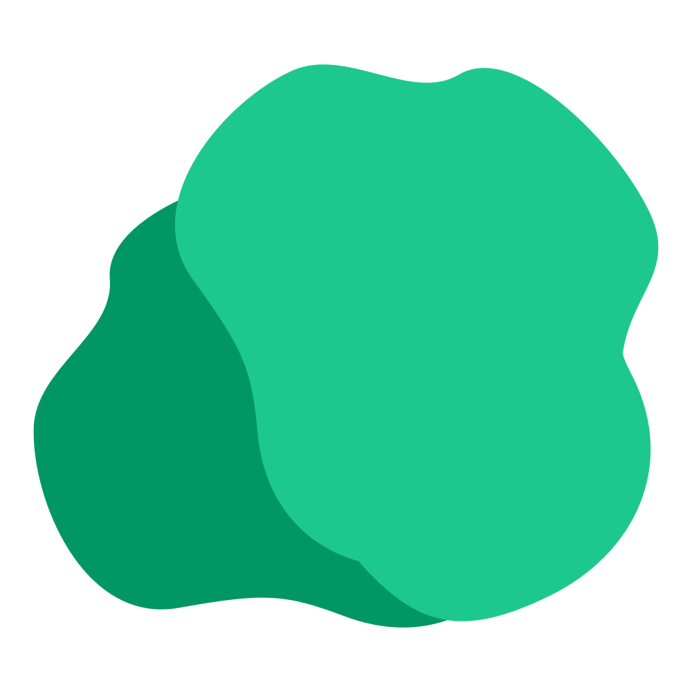

<p align="center">
  
</p>

<h1 align="center">Clay Example Repo</h1>

<p align="center">
  <strong>The documentation of <a href="https://github.com/clay-doc/clay">Clay</a>, written with Clay, in English and German.</strong>
</p>

<p align="center">
  <a href="https://clay-doc.github.io/clay-example-repo/"></a>
  <a href="https://www.npmjs.com/package/clay-doc"></a>
  <a href="https://github.com/clay-doc/clay-example-repo"></a>
</p>

---

This repository is two things at once: the **documentation of Clay**, published at
[clay-doc.github.io/clay-example-repo](https://clay-doc.github.io/clay-example-repo/), and a **complete example** of a
Clay project to copy from. Every feature it documents is in use here: folders and ordering, code notations, alerts,
translations, build checks and the GitHub Pages deployment.

> [!TIP]
> To learn Clay, read the [documentation](https://clay-doc.github.io/clay-example-repo/). To see how something is
> done, find its page in `docs/` and look at the source.

## Structure

```text
.
├── docs/                          # The pages, one Markdown file each
│   ├── index.md                   # The start page
│   ├── introduction.md
│   ├── introduction.de.md         # German translation, next to the original
│   ├── getting-started/           # index.md (the section's page), installation, quick start, …
│   ├── writing/                   # Pages, Markdown, code blocks, alerts, links, HTML
│   ├── organizing/                # Navigation, folders, index pages, clay edit
│   ├── configuration/             # clay.yaml, front matter, environment variables
│   ├── features/                  # Search, SEO, page details, themes and icons
│   ├── versions-and-languages/    # Versions and translations
│   ├── cli/                       # Commands and build checks
│   ├── deployment/                # GitHub Pages and other hosts
│   └── guides/                    # Upgrading to Clay 3, migrating from Clay 1, troubleshooting
├── clay.yaml                      # Site settings, with values per language
├── logo.svg                       # Logo and favicon
├── package.json                   # Clay as a dev dependency
└── .github/
    ├── workflows/deploy.yaml      # Builds with --strict and deploys to GitHub Pages
    └── dependabot.yml             # Keeps Clay and the actions up to date
```

## Running it locally

Needs Node.js 20.19 or newer.

```bash
git clone https://github.com/clay-doc/clay-example-repo.git
cd clay-example-repo
npm install
npm run dev       # live preview at http://localhost:3000
npm run build     # static site in publish/public
npm run preview   # serve the build like GitHub Pages does
```

## Contributing

Corrections and additions are welcome. Every page has an **Edit this page** link that opens it on GitHub. When you
change a page, please update its translation (`*.de.md`) too, or mention in the pull request that it needs an
update; until then, the German page shows the older text.

## Related

- [Clay](https://github.com/clay-doc/clay): the documentation framework.
- [clay-doc on npm](https://www.npmjs.com/package/clay-doc).

## License

This project is licensed under the Apache License 2.0; see [LICENSE](LICENSE) for details.
