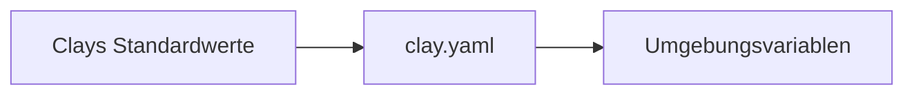

# Konfiguration

Einstellungen liegen an drei Orten, von der ganzen Website bis zur einzelnen Seite:

::: cards
- [clay.yaml](clay-yaml.md)
- [Front Matter](front-matter.md)
- [Umgebungsvariablen](environment-variables.md)
:::

## Die drei Orte

::: tabs
== clay.yaml
Die Website: Titel, Adressen, Links in der Navigationsleiste, Versionen und Sprachen.

```yaml
title: "Mein Projekt"
baseURL: "/mein-projekt/"
siteURL: "https://meine-org.github.io"
languages: ["en", "de"]
```
== Front Matter
Eine Seite oder ein Ordner: Titel, Icon, Beschreibung, Reihenfolge und Aufbau.

```markdown
---
title: Einrichtung
icon: fa-solid fa-wrench
order: 2
---
```
== Umgebungsvariablen
Ein Build: eine Testseite, ein Fork oder ein Geheimnis, das nicht ins Repository gehört.

```bash
CLAY_BASE_URL="/preview/" npx clay build
```
:::

## Welcher Wert gewinnt



Ein weiter rechts gesetzter Wert ersetzt den davor. Front Matter gehört zu einer einzelnen Seite und kommt den anderen nie in die Quere.

## Das Wichtigste

- **Alles hat einen Standardwert.** Eine `clay.yaml` nur mit `title` und schlichte Markdown-Dateien ergeben eine funktionierende Website.
- **Umgebungsvariablen gewinnen.** Sie überschreiben die `clay.yaml` für einen Build, ohne die Datei zu ändern.
- **Tippfehler werden gemeldet.** Ein unbekannter Schlüssel in der `clay.yaml` ist bei jedem Build eine Warnung, siehe [Build-Prüfungen](../publishing/build-checks.md).
- **YAML musst du nicht von Hand bearbeiten.** `clay edit` ändert Einstellungen und Front Matter und behält deine Kommentare und Formatierung. Siehe [clay edit](../organizing/clay-edit.md).
