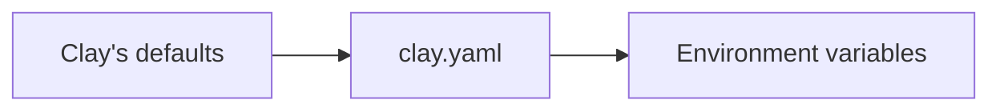

# Configuration

Settings live in three places, from the whole site down to a single page:

::: cards
- [clay.yaml](clay-yaml.md)
- [Front Matter](front-matter.md)
- [Environment Variables](environment-variables.md)
:::

## The three places

::: tabs
== clay.yaml
The site: title, addresses, navbar links, versions and languages.

```yaml
title: "My Project"
baseURL: "/my-project/"
siteURL: "https://my-org.github.io"
languages: ["en", "de"]
```
== Front matter
A page or a folder: title, icon, description, order and layout.

```markdown
---
title: Setup
icon: fa-solid fa-wrench
order: 2
---
```
== Environment variables
One build: a staging site, a fork, or a secret that does not belong in the repository.

```bash
CLAY_BASE_URL="/preview/" npx clay build
```
:::

## Which value wins



A value set further right replaces the one before it. Front matter belongs to a single page and never clashes with the others.

## Key ideas

- **Everything has a default.** A `clay.yaml` with just a `title` and plain Markdown files make a working site.
- **Environment variables win.** They override `clay.yaml` for one build, without changing the file.
- **Typos are reported.** An unknown key in `clay.yaml` is a warning in every build, see [build checks](../publishing/build-checks.md).
- **You don't have to edit YAML by hand.** `clay edit` changes settings and front matter and keeps your comments and formatting. See [clay edit](../organizing/clay-edit.md).
