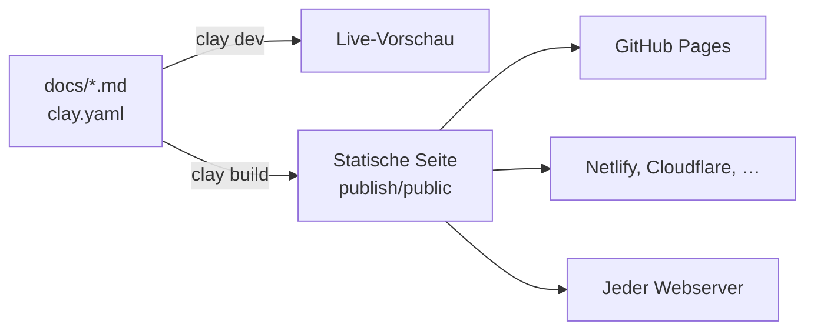

# Einführung

Clay macht aus einem Ordner voller Markdown-Dateien eine schnelle, durchsuchbare Dokumentationsseite. Du schreibst Seiten in Markdown, beschreibst deine Seite in einer kleinen Konfigurationsdatei, und Clay erzeugt eine statische Seite, die du überall hosten kannst: auf GitHub Pages, Netlify, Cloudflare Pages oder jedem Webserver.

Diese Website ist selbst eine Clay-Seite. Jede Seite, die du hier liest, ist eine Markdown-Datei im [Beispiel-Repository](https://github.com/clay-doc/clay-example-repo), und das Repository dient zugleich als Vorlage zum Abschauen.

## So funktioniert es



Ein Clay-Projekt ist ein Ordner mit einer Konfigurationsdatei und deiner Dokumentation:

```tree
mein-projekt/
  clay.yaml     # Titel und Links der Seite
  docs/         # deine Markdown-Seiten, Bilder und Dateien
    index.md    # optional: die Startseite
```

Du arbeitest mit drei Befehlen:

```bash
npx clay dev       # Live-Vorschau beim Schreiben
npx clay build     # die statische Seite nach publish/public bauen
npx clay preview   # den Build so prüfen, wie ein Webhoster ihn ausliefert
```

Clay ist ein einziges npm-Paket, `clay-doc`. Es baut auf [Nuxt](https://nuxt.com) und [Vue](https://vuejs.org) auf, aber du kommst mit keinem davon in Berührung: kein Theme einzurichten, kein Code zu schreiben.

## Was du bekommst

::: cards
- [Bereit für KI](../features/ai-and-agents.md) {fa-solid fa-robot}
  Jede Seite als Markdown, llms.txt und Befehle, die Coding-Agenten verstehen.
- [Navigation](../organizing/navigation.md) {fa-solid fa-sitemap}
  Eine Seitenleiste aus deinen Ordnern, Brotkrumen und Links zur vorigen und nächsten Seite.
- [Suche](../features/search.md) {fa-solid fa-magnifying-glass}
  Jede Seite und jeder Abschnitt, Tippfehler verziehen, nach Bereichen gefiltert.
- [Code](../writing/code-blocks.md) {fa-solid fa-code}
  Hervorhebung für über 200 Sprachen, markierte Zeilen, Diffs und ein Kopierknopf.
- [Komponenten](../writing/components/index.md) {fa-solid fa-puzzle-piece}
  Tabs, Schritte, Karten, Diagramme, Formeln und Dateibäume in schlichtem Markdown.
- [Suchmaschinen](../features/seo.md) {fa-solid fa-chart-line}
  Titel, Beschreibungen, kanonische Links, eine Sitemap und strukturierte Daten.
- [Hell und dunkel](../features/themes-and-icons.md) {fa-solid fa-circle-half-stroke}
  Folgt dem System der Leser, mit einem Schalter, der sich ihre Wahl merkt.
- [Versionen](../organizing/versions.md) {fa-solid fa-code-branch}
  Die Dokumentation älterer Releases bleibt online, mit Versionswahl.
- [Sprachen](../organizing/translations.md) {fa-solid fa-language}
  Übersetze Seite für Seite; nicht übersetzte Seiten zeigen das Original.
:::

Jede Seite wird vorab als HTML gerendert: Sie lädt schnell, funktioniert ohne JavaScript und passt auf kleine Bildschirme, mit der Navigation in einer Schublade.

## Wie es weitergeht

::: steps
1. **Installiere Clay**, siehe [Installation](installation.md).
2. **Bau eine erste Seite** in fünf Minuten mit dem [Schnellstart](quick-start.md).
3. **Schreib deine Seiten**, siehe [Schreiben](../writing/index.md).
4. **Veröffentliche** auf [GitHub Pages](../publishing/github-pages.md) oder [bei einem anderen Hoster](../publishing/other-hosts.md).
:::

> [!NOTE]
> Du kommst von Clay 1 und Clay Oven? Beginne mit dem [Umstieg auf Clay 2](../guides/upgrading-to-clay-2.md).
