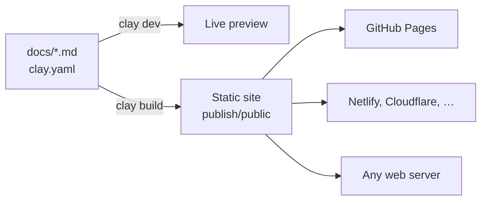

# Introduction

Clay turns a folder of Markdown files into a fast, searchable documentation website. You write pages in Markdown, describe your site in one small configuration file, and Clay builds a static site that you can host anywhere: GitHub Pages, Netlify, Cloudflare Pages or any web server.

This website is itself a Clay site. Every page you read here is a Markdown file in the [example repository](https://github.com/clay-doc/clay-example-repo), and the repository doubles as a reference you can copy from.

## How it works



A Clay project is a folder with a configuration file and your docs:

```tree
my-project/
  clay.yaml     # site title and links
  docs/         # your Markdown pages, images and files
    index.md    # optional: the start page
```

You work with three commands:

```bash
npx clay dev       # live preview while you write
npx clay build     # build the static site into publish/public
npx clay preview   # check the build the way a web host serves it
```

Clay is a single npm package, `clay-doc`. It builds on [Nuxt](https://nuxt.com) and [Vue](https://vuejs.org), but you never touch either: there is no theme to set up and no code to write.

## What you get

::: cards
- [Ready for AI](../features/ai-and-agents.md) {fa-solid fa-robot}
  Every page as Markdown, llms.txt, and commands that coding agents understand.
- [Navigation](../organizing/navigation.md) {fa-solid fa-sitemap}
  A sidebar from your folders, breadcrumbs, and previous and next links on every page.
- [Search](../features/search.md) {fa-solid fa-magnifying-glass}
  Every page and section, typos forgiven, filtered by section.
- [Code](../writing/code-blocks.md) {fa-solid fa-code}
  Highlighting for over 200 languages, highlighted lines, diffs and a copy button.
- [Components](../writing/components/index.md) {fa-solid fa-puzzle-piece}
  Tabs, steps, cards, diagrams, math and file trees in plain Markdown.
- [Search engines](../features/seo.md) {fa-solid fa-chart-line}
  Titles, descriptions, canonical links, a sitemap and structured data.
- [Light and dark](../features/themes-and-icons.md) {fa-solid fa-circle-half-stroke}
  Follows the reader's system, with a switch that remembers their choice.
- [Versions](../organizing/versions.md) {fa-solid fa-code-branch}
  The docs of older releases stay online, with a version switcher.
- [Languages](../organizing/translations.md) {fa-solid fa-language}
  Translate page by page; untranslated pages show the original.
:::

Every page is pre-rendered to HTML: it loads fast, works without JavaScript and fits small screens, with the navigation in a drawer.

## Where to go next

::: steps
1. **Install Clay**, see [installation](installation.md).
2. **Build a first site** in five minutes with the [quick start](quick-start.md).
3. **Write your pages**, see [Writing](../writing/index.md).
4. **Publish** on [GitHub Pages](../publishing/github-pages.md) or [another host](../publishing/other-hosts.md).
:::

> [!NOTE]
> Coming from Clay 1 and Clay Oven? Start with [upgrading to Clay 2](../guides/upgrading-to-clay-2.md).
