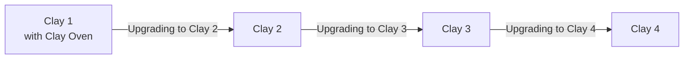

# Guides

Upgrading from earlier versions of Clay, and solutions for common problems.

## Which guide do I need?

| Your site runs on | Follow, in this order |
|-------------------|-----------------------|
| Clay 3 | [Clay 4](upgrading-to-clay-4.md) |
| Clay 2 | [Clay 3](upgrading-to-clay-3.md), then [Clay 4](upgrading-to-clay-4.md) |
| Clay 1 with Clay Oven | [Clay 2](upgrading-to-clay-2.md), then [Clay 3](upgrading-to-clay-3.md), then [Clay 4](upgrading-to-clay-4.md) |

Not sure which version you run? `npx clay --version` tells you.

## Before you upgrade

::: steps
1. **Commit your work**, so the upgrade is one change you can review and undo.
2. **Read the guide** for the next version, and its "At a glance" table.
3. **Upgrade one major version at a time**, and finish each guide with `npx clay build --strict`: when it passes, that step is done.
:::

The [changelog](https://github.com/clay-doc/clay/blob/main/CHANGELOG.md) lists every change of every release, including the small ones that need no guide.

> [!TIP]
> Stuck? [Troubleshooting](troubleshooting.md) covers missing styles, images, icons and dates, and failing builds.
