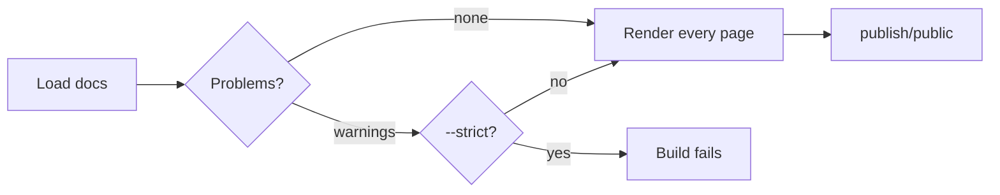

# Build Checks

Every `clay build` checks your docs before it renders them. Problems are reported as warnings under the step that found them:

```text
●  Loaded 12 pages from docs · 280ms
│  ▲ clay.yaml: unknown key "navbar.lgo" is ignored (typo?)
│  ▲ Broken link in guides/setup.md: "instal.md" points to a missing page (/guides/instal)
```



## What is checked

| Check | Example warning |
|-------|-----------------|
| Links to pages that do not exist | `Broken link in guides/setup.md: "instal.md" points to a missing page (/guides/instal)` |
| Links to sections that do not exist | `Broken link in index.md: "guides/setup.md#instal" points to a missing section (#instal on /guides/setup)` |
| Images and files that do not exist | `Broken link in index.md: "img/logo.png" points to a missing file` |
| [Snippets](../writing/snippets-and-variables.md) that cannot be included | `docs/guides/setup.md: includes "../_snippets/gone.md", which does not exist; it is left out` |
| Unknown settings in `clay.yaml` | `clay.yaml: unknown key "navbar.lgo" is ignored (typo?)` |
| Front matter from Clay 3 | `guides/index.md: "cards" is no longer read since Clay 4; it is called "list"` |
| Files and settings from Clay 2 | `dir-meta.yaml is no longer read since Clay 3; give each folder an index.md with its title, icon and order` |
| A missing site title | `clay.yaml: "title" is not set` |
| Settings from Clay 1 | `clay.yaml: "langs" is no longer needed and is ignored` |
| Translations without an original | `setup.de.md: translates setup.md, which does not exist; the file is skipped` |
| Unusable language codes | `clay.yaml: "Deutsch" is not a language code like "en" or "pt-BR"; it is ignored` |
| Unusable or clashing versions | `docs/1.x: docs/latest/1.x has the same URL as this version; rename one of them` |
| Missing git history | `the docs are not in a git repository: last-updated dates are skipped` |

Links, images and videos written in HTML (`<a href>`, ``, `<video src>`) are checked like Markdown ones. Links to other websites are not checked.

## --strict

```bash
npx clay build --strict
```

With `--strict`, warnings fail the build. Use it in CI: a typo in a link then stops the deployment instead of reaching your readers.

```text
✖  Loading docs
│  ▲ Broken link in guides/setup.md: "instal.md" points to a missing page (/guides/instal)
│  clay build --strict: 1 problem(s) found, see the warnings above
│
└  Build failed after 290ms. Run "clay build --verbose" for the full output.
```

Missing git history is the one warning that never fails a build: it only means the pages show no dates.

To catch problems before they are merged, run the same check on every pull request:

::: prompt
Add a GitHub Actions workflow, .github/workflows/docs-check.yaml, that runs
`npx clay build --strict` on every pull request that changes docs/ or
clay.yaml. Set up Node.js like the deploy workflow in
https://clay-doc.github.io/clay-example-repo/publishing/github-pages.md,
check out the full history, and do not deploy anything.
:::

## When a build fails

Some problems stop every build, strict or not, for example a page that cannot be rendered. Clay marks the step that failed and shows the cause:

```text
✖  Prerendering pages
│  404 Page Not Found on 1 page: /guides/old-page
│  Exiting due to prerender errors.
```

Here a page links to an address that does not exist, in a way the link check could not see, for example in raw HTML. Fix the link and build again. When a page itself cannot be rendered, the line above names the cause and the page, for example `Cannot read properties of undefined (rendering /guides/setup)`.

For the complete output of the underlying build tools, run:

```bash
npx clay build --verbose
```

> [!TIP]
> Run `npx clay build --strict` locally before you push. It takes a few seconds and catches the same problems CI would.
