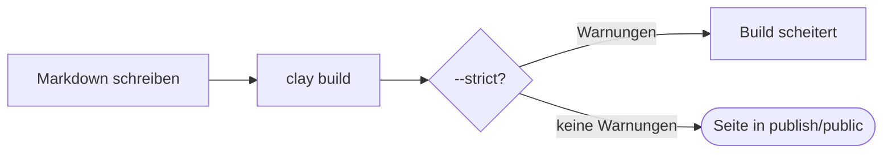
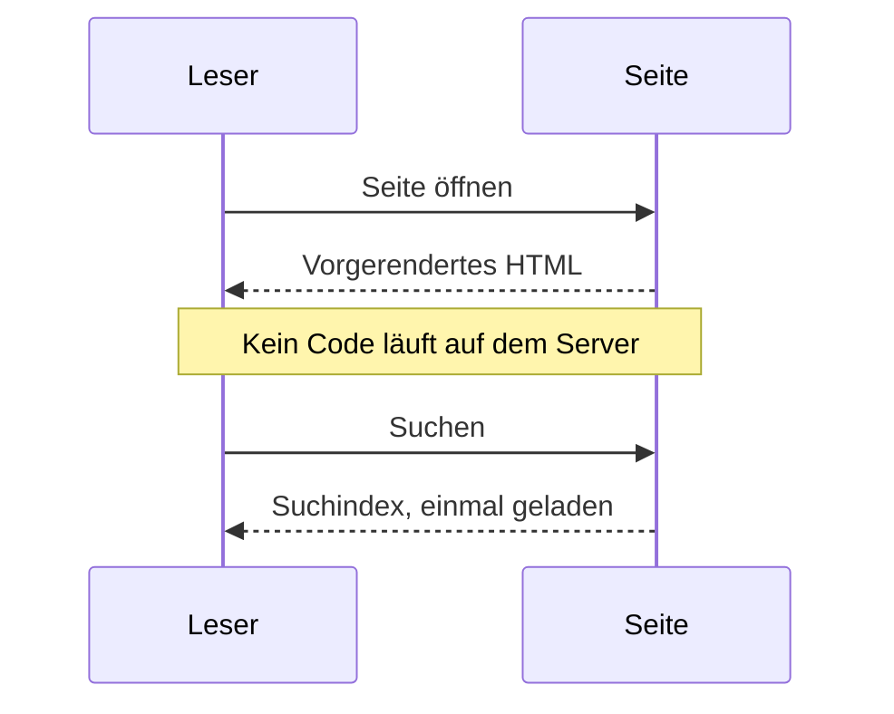
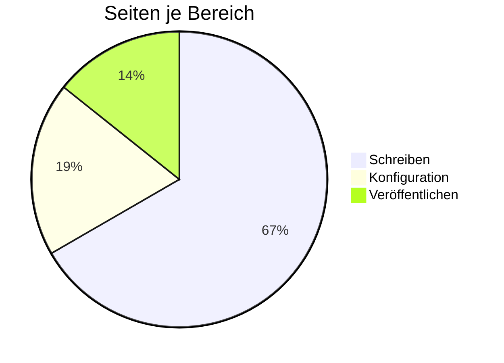

# Diagramme

Zeichne Diagramme aus Text mit [Mermaid](https://mermaid.js.org): Schreib einen Codeblock in der Sprache `mermaid`, und Clay zeichnet ihn in den Farben deiner Seite, hell oder dunkel.

## Flussdiagramme

````markdown

````


## Sequenzdiagramme

````markdown

````


## Kreisdiagramme

````markdown

````


Mermaid zeichnet viele weitere Arten: Zustands-, Klassen- und Entity-Relationship-Diagramme, Gantt-Diagramme, Zeitleisten, Mindmaps und Git-Graphen. Seine [Dokumentation](https://mermaid.js.org/intro/) zeigt jede mit Beispielen.

## Wie Diagramme gezeichnet werden

- **In den Farben deiner Seite.** Kästen, Linien und Text nehmen die Farben des hellen oder dunklen Designs an und werden neu gezeichnet, wenn Leser umschalten.
- **Nur wo nötig.** Mermaid ist groß, der Browser lädt es nur auf Seiten mit Diagrammen.
- **Bevor es geladen ist**, oder ohne JavaScript, erscheint der Quelltext des Diagramms.
- **Sicher.** Beschriftungen sind Text: Diagramme können keine Skripte ausführen, und Klicks darin bewirken nichts.
- **Fehler** zeigen eine Meldung mit dem Quelltext darunter, damit du siehst, was zu korrigieren ist.

> [!TIP]
> Gib einem Diagramm einen Titel und eine Beschreibung für Screenreader, mit Zeilen `accTitle: …` und `accDescr: …` unter seiner ersten Zeile.

## Auf GitHub

GitHub zeichnet `mermaid`-Codeblöcke ebenfalls, Diagramme sehen also auch im Repository richtig aus.
