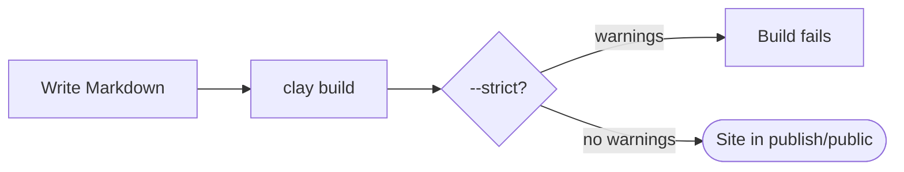
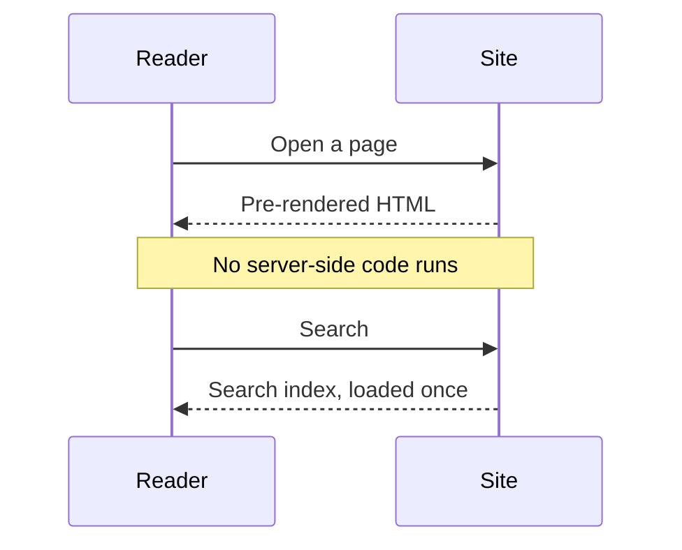
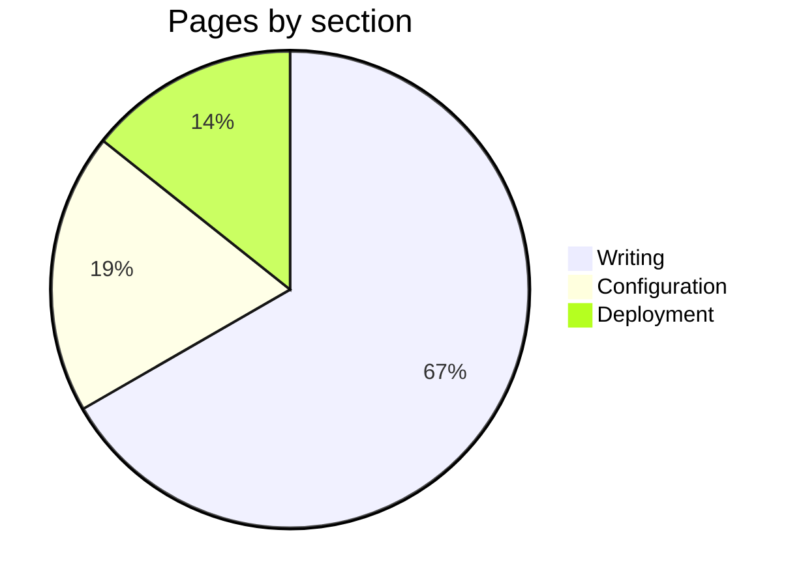

# Diagrams

Draw diagrams from text with [Mermaid](https://mermaid.js.org): write a code block in the language `mermaid`, and Clay draws it in the colors of your site, light or dark.

## Flowcharts

````markdown

````



## Sequence diagrams

````markdown

````


## Pie charts

````markdown

````


Mermaid draws many more kinds: state, class and entity-relationship diagrams, Gantt charts, timelines, mind maps and Git graphs. Its [documentation](https://mermaid.js.org/intro/) shows each with examples.

## How diagrams are drawn

- **In your site's colors.** Boxes, lines and text take the colors of the light or the dark theme, and are drawn again when a reader switches.
- **Only where needed.** Mermaid is large, so the browser only loads it on pages with diagrams.
- **Before it loads**, or without JavaScript, the diagram's source shows instead.
- **Safely.** Labels are text: diagrams cannot run scripts, and clicks in them do nothing.
- **Mistakes** show a message with the source below it, so you see what to fix.

> [!TIP]
> Give a diagram a title and a description for screen readers with `accTitle: …` and `accDescr: …` lines below its first line.

## On GitHub

GitHub draws `mermaid` code blocks too, so diagrams look right in the repository as well.
