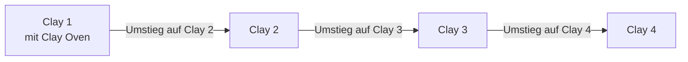

# Anleitungen

Umstieg von älteren Clay-Versionen und Lösungen für häufige Probleme.

::: cards
- [Umstieg auf Clay 4](upgrading-to-clay-4.md)
- [Umstieg auf Clay 3](upgrading-to-clay-3.md)
- [Umstieg auf Clay 2](upgrading-to-clay-2.md)
- [Problemlösung](troubleshooting.md)
:::

## Welche Anleitung brauche ich?

| Deine Seite läuft mit | Folge, in dieser Reihenfolge |
|-----------------------|------------------------------|
| Clay 3 | [Clay 4](upgrading-to-clay-4.md) |
| Clay 2 | [Clay 3](upgrading-to-clay-3.md), dann [Clay 4](upgrading-to-clay-4.md) |
| Clay 1 mit Clay Oven | [Clay 2](upgrading-to-clay-2.md), dann [Clay 3](upgrading-to-clay-3.md), dann [Clay 4](upgrading-to-clay-4.md) |

Unsicher, welche Version du nutzt? `npx clay --version` verrät es.

## Vor dem Umstieg

::: steps
1. **Committe deine Arbeit**, damit der Umstieg eine Änderung ist, die du prüfen und zurücknehmen kannst.
2. **Lies die Anleitung** für die nächste Version und ihre Tabelle „Auf einen Blick“.
3. **Steig eine Hauptversion nach der anderen um** und beende jede Anleitung mit `npx clay build --strict`: Läuft es durch, ist dieser Schritt geschafft.
:::

Das [Changelog](https://github.com/clay-doc/clay/blob/main/CHANGELOG.md) listet jede Änderung jedes Releases, auch die kleinen, die keine Anleitung brauchen.

> [!TIP]
> Du steckst fest? Die [Problemlösung](troubleshooting.md) behandelt fehlende Styles, Bilder, Icons und Daten sowie scheiternde Builds.
