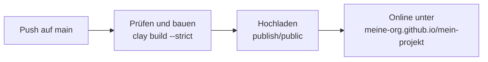

# GitHub Pages

[GitHub Pages](https://pages.github.com) hostet statische Seiten kostenlos, direkt aus einem Repository. Mit dem Workflow auf dieser Seite prüft jeder Push auf `main` die Dokumentation, baut die Seite und veröffentlicht sie. Diese Website wird genau so veröffentlicht.



## Einrichten

::: steps
1. **Setz die Basis-URL.** Die Seite eines Repositorys liegt unter seinem Namen, `https://<besitzer>.github.io/<repository>/`. Sag es Clay in der `clay.yaml`:

   ```yaml [clay.yaml]
   baseURL: "/mein-projekt/"
   siteURL: "https://meine-org.github.io"
   ```

   | Art der Seite | Adresse | `baseURL` |
   |---------------|---------|-----------|
   | Projektseite | `https://meine-org.github.io/mein-projekt/` | `/mein-projekt/` |
   | Seite eines Nutzers oder einer Organisation (Repository `meine-org.github.io`) | `https://meine-org.github.io/` | `/` |
   | Eigene Domain | `https://docs.example.com/` | `/` |

2. **Schalte Pages ein.** Öffne im Repository **Settings → Pages** und stell **Source** auf **GitHub Actions**.

3. **Füg den Workflow hinzu** als `.github/workflows/deploy.yaml`, siehe [der Workflow](#der-workflow) unten.

4. **Pushe.** Nach einer Minute ist die Seite online; der Lauf des Workflows zeigt ihre Adresse.
:::

Die Schritte 1 und 3 kann ein Coding-Agent für dich übernehmen:

::: prompt
Lies https://clay-doc.github.io/clay-example-repo/de/publishing/github-pages.md.
Veröffentliche dann die Clay-Dokumentation dieses Repositorys auf GitHub
Pages: Setze baseURL und siteURL in der clay.yaml für die Pages-Adresse dieses
Repositorys, und leg den Workflow als .github/workflows/deploy.yaml an, mit
oder ohne package.json, je nachdem, was zu diesem Repository passt. Prüfe mit
`npx clay build --strict`.
:::

## Der Workflow

::: tabs
== Mit package.json
```yaml [.github/workflows/deploy.yaml]
name: Deploy Docs

on:
  push:
    branches: [main]
  workflow_dispatch:

concurrency:
  group: pages
  cancel-in-progress: true

jobs:
  deploy:
    runs-on: ubuntu-latest
    permissions:
      contents: read
      pages: write
      id-token: write
    environment:
      name: github-pages
      url: ${{ steps.deployment.outputs.page_url }}
    steps:
      - uses: actions/checkout@v7
        with:
          # Ganze Historie, damit Seiten ihr letztes Änderungsdatum zeigen
          fetch-depth: 0

      - uses: actions/setup-node@v7
        with:
          node-version: lts/*
          cache: npm

      - run: npm ci

      # --strict lässt den Build bei kaputten Links und Tippfehlern in der Konfiguration scheitern
      - run: npx clay build --strict

      - uses: actions/configure-pages@v6

      - uses: actions/upload-pages-artifact@v5
        with:
          path: ./publish/public

      - id: deployment
        uses: actions/deploy-pages@v5
```
== Ohne package.json
In Repositories, die keine JavaScript-Projekte sind, führst du eine feste Clay-Version mit `npx` aus; der Rest des Workflows bleibt gleich:

```yaml
    steps:
      - uses: actions/checkout@v7
        with:
          fetch-depth: 0

      - uses: actions/setup-node@v7
        with:
          node-version: lts/*

      # --strict lässt den Build bei kaputten Links und Tippfehlern in der Konfiguration scheitern
      - run: npx clay-doc@4 build --strict

      - uses: actions/configure-pages@v6

      - uses: actions/upload-pages-artifact@v5
        with:
          path: ./publish/public

      - id: deployment
        uses: actions/deploy-pages@v5
```
:::

> [!TIP]
> Um nur zu bauen, wenn sich die Dokumentation ändert, ergänze Pfade im Auslöser:
>
> ```yaml
> on:
>   push:
>     branches: [main]
>     paths: ["docs/**", "docs-archive/**", "clay.yaml", "package-lock.json"]
> ```

## Geheimnisse

Werte, die nicht ins Repository gehören, etwa ein Font-Awesome-Kit, kommen unter **Settings → Secrets and variables → Actions** und erreichen Clay als [Umgebungsvariablen](../configuration/environment-variables.md):

```yaml
      - run: npx clay build --strict
        env:
          CLAY_FONTAWESOME_KIT: ${{ secrets.CLAY_FONTAWESOME_KIT }}
```

## Eigene Domain

Trag die Domain unter **Settings → Pages → Custom domain** ein und folge GitHubs Anleitung für die DNS-Einträge. Liefere die Seite dann von der Wurzel aus:

```yaml [clay.yaml]
baseURL: "/"
siteURL: "https://docs.example.com"
```

An der Wurzel einer Domain lesen Suchmaschinen auch die `robots.txt` der Seite und finden darüber die Sitemap. Projektseiten unter einem Pfad reichen ihre Sitemap selbst ein, siehe [SEO](../features/seo.md#seiten-unter-einem-pfad).

## Clay aktuell halten

Lass Dependabot Clay-Updates als Pull Requests vorschlagen, mit `.github/dependabot.yml`:

```yaml [.github/dependabot.yml]
version: 2
updates:
  - package-ecosystem: npm
    directory: /
    schedule:
      interval: weekly
```

Ergänze einen Workflow, der bei Pull Requests `npx clay build --strict` ausführt, dann ist jedes Update geprüft, bevor du es übernimmst.
