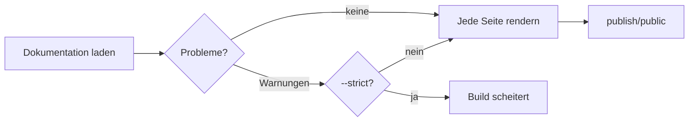

# Build-Prüfungen

Jedes `clay build` prüft deine Dokumentation, bevor es sie rendert. Probleme erscheinen als Warnungen unter dem Schritt, der sie gefunden hat:

```text
●  Loaded 12 pages from docs · 280ms
│  ▲ clay.yaml: unknown key "navbar.lgo" is ignored (typo?)
│  ▲ Broken link in guides/setup.md: "instal.md" points to a missing page (/guides/instal)
```



Die Meldungen selbst sind englisch.

## Was geprüft wird

| Prüfung | Beispiel |
|---------|----------|
| Links auf Seiten, die es nicht gibt | `Broken link in guides/setup.md: "instal.md" points to a missing page (/guides/instal)` |
| Links auf Abschnitte, die es nicht gibt | `Broken link in index.md: "guides/setup.md#instal" points to a missing section (#instal on /guides/setup)` |
| Bilder und Dateien, die es nicht gibt | `Broken link in index.md: "img/logo.png" points to a missing file` |
| Unbekannte Einstellungen in der `clay.yaml` | `clay.yaml: unknown key "navbar.lgo" is ignored (typo?)` |
| Front Matter aus Clay 3 | `guides/index.md: "cards" is no longer read since Clay 4; it is called "list"` |
| Dateien und Einstellungen aus Clay 2 | `dir-meta.yaml is no longer read since Clay 3; give each folder an index.md with its title, icon and order` |
| Ein fehlender Titel | `clay.yaml: "title" is not set` |
| Einstellungen aus Clay 1 | `clay.yaml: "langs" is no longer needed and is ignored` |
| Übersetzungen ohne Original | `setup.de.md: translates setup.md, which does not exist; the file is skipped` |
| Unbrauchbare Sprachcodes | `clay.yaml: "Deutsch" is not a language code like "en" or "pt-BR"; it is ignored` |
| Unbrauchbare oder kollidierende Versionen | `docs-archive/1.x: docs/1.x has the same URL as this version; rename one of them` |
| Fehlende Git-Historie | `the docs are not in a git repository: last-updated dates are skipped` |

Links zu anderen Websites werden nicht geprüft.

## --strict

```bash
npx clay build --strict
```

Mit `--strict` lassen Warnungen den Build scheitern. Nutze es in der CI: Ein Tippfehler in einem Link stoppt dann die Veröffentlichung, statt deine Leser zu erreichen.

```text
✖  Loading docs
│  ▲ Broken link in guides/setup.md: "instal.md" points to a missing page (/guides/instal)
│  clay build --strict: 1 problem(s) found, see the warnings above
│
└  Build failed after 290ms. Run "clay build --verbose" for the full output.
```

Fehlende Git-Historie ist die einzige Warnung, die einen Build nie scheitern lässt: Sie bedeutet nur, dass die Seiten keine Daten zeigen.

Damit Probleme gar nicht erst gemergt werden, lass dieselbe Prüfung bei jedem Pull Request laufen:

::: prompt
Leg einen GitHub-Actions-Workflow an, .github/workflows/docs-check.yaml, der
`npx clay build --strict` bei jedem Pull Request ausführt, der docs/,
docs-archive/ oder clay.yaml ändert. Richte Node.js ein wie der Deploy-Workflow
in https://clay-doc.github.io/clay-example-repo/de/publishing/github-pages.md,
checke die ganze Historie aus und veröffentliche nichts.
:::

## Wenn ein Build scheitert

Manche Probleme stoppen jeden Build, ob streng oder nicht, etwa eine Seite, die sich nicht rendern lässt. Clay markiert den gescheiterten Schritt und zeigt die Ursache:

```text
✖  Prerendering pages
│  404 Page Not Found on 1 page: /guides/old-page
│  Exiting due to prerender errors.
```

Hier verlinkt eine Seite auf eine Adresse, die es nicht gibt, und zwar so, dass die Link-Prüfung es nicht sehen konnte, etwa in rohem HTML. Korrigiere den Link und baue neu. Lässt sich eine Seite selbst nicht rendern, nennt die Zeile darüber die Ursache und die Seite, etwa `Cannot read properties of undefined (rendering /guides/setup)`.

Für die vollständige Ausgabe der zugrunde liegenden Werkzeuge:

```bash
npx clay build --verbose
```

> [!TIP]
> Führe `npx clay build --strict` vor dem Pushen lokal aus. Es dauert ein paar Sekunden und findet dieselben Probleme wie die CI.
