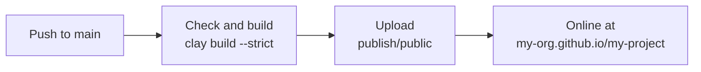

# GitHub Pages

[GitHub Pages](https://pages.github.com) hosts static sites for free, straight from a repository. With the workflow on this page, every push to `main` checks the docs, builds the site and publishes it. This site is deployed exactly this way.



## Setting it up

::: steps
1. **Set the base URL.** A repository's site lives under its name, `https://<owner>.github.io/<repository>/`. Tell Clay in `clay.yaml`:

   ```yaml
   baseURL: "/my-project/"
   siteURL: "https://my-org.github.io"
   ```

   | Kind of site | Address | `baseURL` |
   |--------------|---------|-----------|
   | Project site | `https://my-org.github.io/my-project/` | `/my-project/` |
   | User or organization site (repository `my-org.github.io`) | `https://my-org.github.io/` | `/` |
   | Custom domain | `https://docs.example.com/` | `/` |

2. **Turn on Pages.** In the repository, open **Settings → Pages** and set **Source** to **GitHub Actions**.

3. **Add the workflow** as `.github/workflows/deploy.yaml`, see [the workflow](#the-workflow) below.

4. **Push.** After a minute, the site is online; the workflow run shows its address.
:::

## The workflow

::: tabs
== With package.json
```yaml
name: Deploy Docs

on:
  push:
    branches: [main]
  workflow_dispatch:

concurrency:
  group: pages
  cancel-in-progress: true

jobs:
  deploy:
    runs-on: ubuntu-latest
    permissions:
      contents: read
      pages: write
      id-token: write
    environment:
      name: github-pages
      url: ${{ steps.deployment.outputs.page_url }}
    steps:
      - uses: actions/checkout@v7
        with:
          # Full history, so pages can show when they were last updated
          fetch-depth: 0

      - uses: actions/setup-node@v7
        with:
          node-version: lts/*
          cache: npm

      - run: npm ci

      # --strict fails the build on broken links and typos in the config
      - run: npx clay build --strict

      - uses: actions/configure-pages@v6

      - uses: actions/upload-pages-artifact@v5
        with:
          path: ./publish/public

      - id: deployment
        uses: actions/deploy-pages@v5
```
== Without package.json
In repositories that are not JavaScript projects, run a fixed Clay version with `npx`; the rest of the workflow stays the same:

```yaml
    steps:
      - uses: actions/checkout@v7
        with:
          fetch-depth: 0

      - uses: actions/setup-node@v7
        with:
          node-version: lts/*

      # --strict fails the build on broken links and typos in the config
      - run: npx clay-doc@4 build --strict

      - uses: actions/configure-pages@v6

      - uses: actions/upload-pages-artifact@v5
        with:
          path: ./publish/public

      - id: deployment
        uses: actions/deploy-pages@v5
```
:::

> [!TIP]
> To build only when the docs change, add paths to the trigger:
>
> ```yaml
> on:
>   push:
>     branches: [main]
>     paths: ["docs/**", "docs-archive/**", "clay.yaml", "package-lock.json"]
> ```

## Secrets

Values that should not be in the repository, like a Font Awesome kit, go into **Settings → Secrets and variables → Actions** and reach Clay as [environment variables](../configuration/environment-variables.md):

```yaml
      - run: npx clay build --strict
        env:
          CLAY_FONTAWESOME_KIT: ${{ secrets.CLAY_FONTAWESOME_KIT }}
```

## Custom domain

Set the domain in **Settings → Pages → Custom domain** and follow GitHub's instructions for the DNS records. Then serve the site from the root:

```yaml
baseURL: "/"
siteURL: "https://docs.example.com"
```

At the root of a domain, search engines also read the site's `robots.txt` and find the sitemap through it. Project sites under a path submit their sitemap themselves, see [SEO](../features/seo.md#sites-under-a-path).

## Keeping Clay up to date

Let Dependabot propose Clay updates as pull requests, with `.github/dependabot.yml`:

```yaml
version: 2
updates:
  - package-ecosystem: npm
    directory: /
    schedule:
      interval: weekly
```

Add a workflow that runs `npx clay build --strict` on pull requests, and every update is checked before you merge it.
